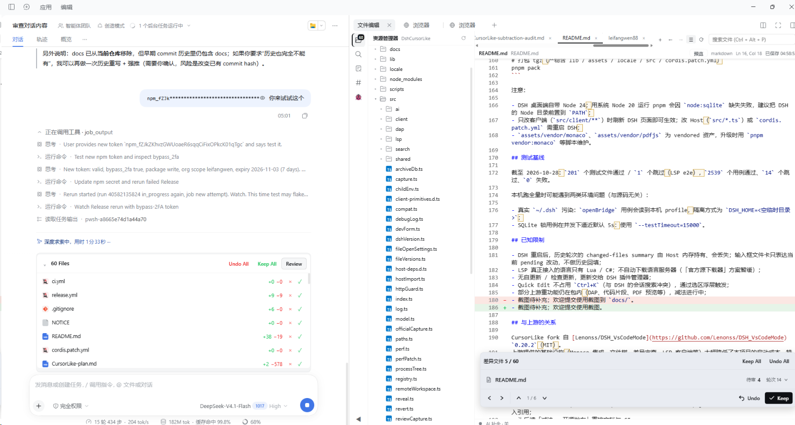

# CursorLike

[](https://www.npmjs.com/package/dsh-cursorlike)
[](https://github.com/leifangwen88/dsh-cursorlike/releases)
[](LICENSE)

> **给 DeepSeek Harness 的 Cursor 式编码工作台。**
> 输入框上方待审文件卡 + 官方右侧栏 Monaco 编辑器 + 差异审查 + AI 补全/内联编辑。

CursorLike 是 [dsh-vscode-mode](https://github.com/Lenonss/DSH_VsCodeMode)（MIT）的社区 fork：
保留上游的编辑器、文件树、差异审查与 AI 基础，围绕 Cursor 的核心动线重构了「会话级文件浏览卡」，
并把不进入主路径的重功能逐步做减法。

- 当前版本：`0.1.1`（已发布到 npm 与 GitHub Releases）
- 安装：`dsh plugin add dsh-cursorlike`
- 目标 DSH：`0.2.1-rc.x`（`engines.dsh: >=0.1.0-rc.1 <0.3.0-0`，cordis `>=4.0.0-rc <5`）
- 许可证：MIT（保留上游版权与许可声明）

## 截图

<p align="center">
  
</p>

<p align="center"><em>对话 + 官方右侧栏编辑器（文件树 / 页签 / Monaco）+ 待审文件卡与差异审查</em></p>

## 特性

### 1. 输入框上方待审文件卡

- 收起态：`N Files`（单文件显示相对路径）+ `Undo All` / `Keep All` / `Review`
- 展开态：每行「文件类型图标 + 文件名 + `+N −M`」，行尾 `×`（拒绝）/ `✓`（采纳）
- 默认收起；用户展开/收起状态按会话记忆
- 点击文件行：有差异打开审查，无差异直接打开编辑器
- 文件已不存在（删除/重命名/插件卸载残留）时显示孤儿状态：`×` 禁用、`✓` 可清除记录
- 列表内部滚动，宽度跟随输入框；数据只表达**当前 pending 改动**，不承担历史回填

### 2. 官方右侧栏编辑器

- DSH 官方右侧 Sidebar Tab：对话与编辑同屏，支持多页签、分屏、浮出、全屏
- 文件树、QuickOpen、工作区搜索、大纲
- Monaco 编辑器：语法高亮、行内差异标记、外部修改保护、`Ctrl+S` 保存
- Markdown 预览 / 图片预览 / PDF 预览
- 文件链接路由固定为 Cursor 策略：代码文件进插件编辑器，图片/Markdown/PDF/Office 交给 DSH 原生预览或系统打开

### 3. 差异审查

- 聊天内联 diff 与 Review 页；Keep / Undo / 归档 / 回滚
- 输入框文件卡与编辑器审查状态联动，处理后文件从 pending 卡消失

### 4. AI 编辑

- **Tab 补全**：Monaco ghost text，复用 `edrv.ai.inline`
- **Quick Edit**：选中代码 → 选区浮层输入指令 → 原/新 diff 预览 → 接受/拒绝；浮层可拖动、自动夹取视口；默认不占用快捷键
- **Add to Chat**：选中代码悬浮条加入对话，带行区间引用
- **拖入输入框**：文件树拖文件/文件夹生成 `@file` / `@folder` 引用 chip

### 5. Markdown 阅读

- 预览走官方 `MarkdownText` 原语（GFM + KaTeX），跟随 DSH 主题
- 对齐 DSH 原生文档预览：代码块「自动换行」开关、相对路径图片解析（`api/file` 路由）、窄面板留白自适应
- `.md` 源码默认软换行（VS Code/Cursor 同款），命令栏可切「切换自动换行」

### 6. 语言智能

- LSP 诊断（`publishDiagnostics` → Monaco markers），与 Monaco 内置 TS/JSON/CSS/HTML 诊断互不覆盖
- 语言服务器状态页：自动检测 + 高级命令/路径；未安装时明确降级为「语法高亮 + AI 补全」
- 当前真正接入 LSP 的语言：Lua / C#；其它语言使用 Monaco 内置语言服务

### 7. 设置

设置页 5 个 Tab：**编辑器** / **AI 补全** / **语言服务器** / **性能优化** / **兼容性**。

- 编辑器：自动保存策略（默认关闭，支持 `afterDelay` / `onFocusChange` / `onWindowChange`）、保存延迟、页签上限、侧边栏最小宽度
- AI 补全：开关、模型与思考档位
- 语言服务器：状态表、自动检测、高级命令/路径
- 性能优化 / 兼容性：维护用报告，不占用主流程

> 仍保留自上游、但不在 Cursor 主路径上的能力：调试器（DAP）、代码片段、PDF/Office 自定义预览、远程打开等。
> 这些会按减法清单逐步收敛，当前版本不保证长期保留。

## 安装

### 开发版（本地 link，可选）

1. 找到 DSH profile（桌面版通常为 `<DSH_HOME>/profiles/desktop/package.json`）；
2. 在 `dependencies` 中增加本仓库的 link（路径用正斜杠）：

   ```json
   "dsh-cursorlike": "link:<本仓库绝对路径>"
   ```

3. 在 `dsh.profile.bundles` 末尾加入包名：

   ```json
   "dsh-cursorlike"
   ```

4. 在 profile 目录执行 `pnpm install`，然后**完全重启 DSH**；
5. 打开一个会话，右侧栏出现「文件编辑」Tab，输入框上方出现待审文件卡即安装成功。

### 安装（npm / GitHub Release 任选）

**A. npm 安装（推荐）**

```bash
dsh plugin add dsh-cursorlike
```

或在 DSH 插件页按包名 `dsh-cursorlike` 安装；插件显示名为 **CursorLike**。安装完成后重启 DSH。

**B. 插件页从 URL 安装（无需 npm）**

1. DSH → 设置 → **插件** → **安装**；
2. 粘贴 Release 资产 URL：

   ```text
   https://github.com/leifangwen88/dsh-cursorlike/releases/download/v<version>/dsh-cursorlike-<version>.tgz
   ```

3. 安装完成后重启 DSH（Host 半不热载）。

**C. 从 GitHub 仓库安装（开发者）**

安装 spec 填 `https://github.com/leifangwen88/dsh-cursorlike`（或 `github:leifangwen88/dsh-cursorlike`）。会拉取源码并执行 `prepare` 构建，首次较慢，且可能需要批准依赖构建脚本。

**D. 命令行（仅非 desktop profile）**

```bash
dsh plugin --profile <profile-name> add dsh-cursorlike
# 或指定 Release tarball
dsh plugin --profile <profile-name> add <Release tarball URL>
```

`dsh plugin` 只把参数转发给 pnpm，不会自动选中组合包；desktop profile 由 Electron 应用独占管理，请使用 A。

## 快捷键

默认键位（可在 DSH 官方快捷键设置中修改）：

| 动作 | 默认键位 |
|---|---|
| 保存文件 | `Ctrl+S` |
| 快速打开文件 | `Ctrl+P` |
| 切换侧边栏 | `Ctrl+B` |
| 工作区搜索 | `Ctrl+Shift+F` |
| 命令面板 | `Ctrl+Shift+P` / `F1` |
| 切换 Markdown 预览 | `Ctrl+Shift+V` |
| 切换自动换行 | 命令面板「切换自动换行」（无默认键位） |
| 转到行 | `Ctrl+G` |
| 后退 / 前进 | `Alt+←` / `Alt+→`（另有 `Ctrl+Alt+-`、`Ctrl+Shift+-`） |
| 下一个 / 上一个页签 | `Ctrl+Alt+→` / `Ctrl+Alt+←`（另有 `Ctrl+PgDn` / `Ctrl+PgUp`） |
| 添加选中内容为引用 | `Ctrl+U` |
| 关闭页签 | `Ctrl+F4` |
| 切换行注释 | `Ctrl+Alt+/` |
| 调试（F5 继续 / F9 断点 / F10 单步跳过 / F11 步入 / Shift+F11 步出 / Shift+F5 停止） | 见 DSH 快捷键设置 |

## 开发

```bash
# 依赖安装（pnpm 11.3.0，Node 24；DSH 桌面自带 Node 目录需前置到 PATH）
pnpm install

# 类型检查
pnpm typecheck

# 测试（vitest；放宽 15s 超时，避免 SQLite 锁用例在并发下抖动）
pnpm exec vitest run --testTimeout=15000

# 构建 host + client（产物在 lib/）
pnpm build

# 打包 tgz（产物含 lib / assets / locale / src / cordis.patch.yml）
pnpm pack
```

注意：

- DSH 桌面端自带 Node 24；用系统 Node 20 运行 pnpm 会因 `node:sqlite` 缺失失败，建议把 DSH 的 Node 目录前置到 `PATH`；
- 只改客户端（`src/client/**`）时刷新 DSH 页面即可生效；改 Host（`src/*.ts`）或 `cordis.patch.yml` 需重启 DSH；
- `assets/vendor/monaco`、`assets/vendor/pdfjs` 为 vendored 资产，升级时用 `pnpm vendor:monaco` 等脚本维护。

## 测试基线

截至 2026-10-28：`201` 个测试文件通过 / `1` 个跳过（LSP e2e），`2539` 个用例通过、`14` 个跳过、`0` 失败。

本机跑全量时可能遇到两类环境问题（与源码无关）：

- 真实 `~/.dsh` 污染：`openBridge` 用例会读到本机 profile，隔离方式为 `DSH_HOME=<空临时目录>`；
- SQLite 锁用例在并发下逼近默认 5s：使用 `--testTimeout=15000`。

## 已知限制

- DSH 重启后，历史轮次的 changed-files summary 由 Host 内存持有、会丢失；输入框文件卡只表达当前 pending 改动，不做历史回填；
- LSP 真正接入的语言只有 Lua / C#；不自动下载语言服务器（「官方源下载器」方案暂缓）；
- 无自更新 / 检查更新，更新交给 DSH 插件管理器；
- Quick Edit 不占用 `Ctrl+K`（与 DSH 的会话搜索冲突），通过选区浮层触发；
- 部分上游重功能仍在包内（DAP、代码片段、PDF 预览等），减法进行中；
- 欢迎提交使用截图到仓库 `assets/screenshots/`。

## 与上游的关系

CursorLike fork 自 [Lenonss/DSH_VsCodeMode](https://github.com/Lenonss/DSH_VsCodeMode) `0.20.2`（MIT）。
上游提供的基础设施（Monaco 集成、文件树、差异审查、LSP 客户端等）大幅降低了本项目的启动成本，特此致谢。

本 fork 的主要差异：

- 更名与重定位（CursorLike），设置页与命令面收敛，移除 SVN、MCP、Unity/系统集成、插件自更新；
- 新增输入框上方待审文件卡（撤销/采纳/审查、孤儿文件状态、按会话记忆）；
- Cursor 式保存策略、文件链接路由、Markdown 预览与软换行增强、Quick Edit / Add to Chat / 拖入引用；
- 为后续「减法 + 开源发布」重排文档与 CI。

## 许可

MIT。详见 [LICENSE](LICENSE) 与 [NOTICE](NOTICE)；LICENSE 保留上游版权与许可声明。
CursorLike 是社区项目，与 Cursor / Anysphere 无关联。
